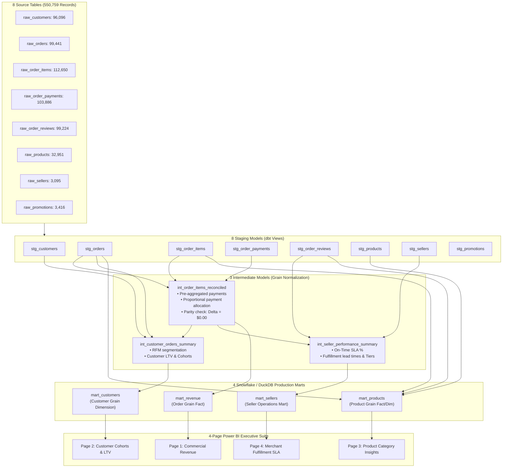

# Ecommerce Commercial Performance Dashboards
### Modern Analytics Engineering Pipeline | Power BI, SQL, dbt, Snowflake, Python, DuckDB

[](https://www.getdbt.com/)
[](https://duckdb.org/)
[](https://www.snowflake.com/)
[](#automated-quality-test-suite)
[](#financial-reconciliation--audit)

---

## Executive Summary
This enterprise portfolio project implements an end-to-end commercial analytics platform modeling **550,759 records** across **8 raw source tables** into **4 production analytical marts** powering a **four-page executive Power BI reporting suite**.

* **550,759 Records Modeled Across 8 Source Tables:** Engineered a full relational pipeline using SQL, Python, and 15 dbt models across staging, intermediate, and marts layers.
* **54 Automated Quality Tests & Cent-Level Parity:** Enforced referential integrity, primary key uniqueness, schema domains, and verified revenue against raw payment sources to the exact cent ($0.00 variance).
* **Four-Page Power BI Suite:** Built semantic models and DAX measures covering **Commercial Revenue**, **Customer Cohorts & LTV**, **Product Catalog Performance**, and **Seller Operations**.
* **Grain-Aware Join Engineering:** Solved the classic Cartesian fan-out trap between multi-item orders and multi-tender split payments, preventing phantom revenue inflation and preserving audit-grade precision.

---

## Architecture & Data Lineage



---

## The Grain-Aware Join Challenge

In commercial e-commerce schemas, a naive join between `order_items` (112,650 rows) and `order_payments` (103,886 rows) creates a **Cartesian fan-out** whenever an order contains both multiple items and split payment methods:

```sql
-- DANGEROUS NAIVE JOIN: Artificially duplicates revenue!
SELECT 
    SUM(items.price) AS inflated_merchandise_sum,
    SUM(pmt.payment_value) AS inflated_cash_sum
FROM raw_order_items items
JOIN raw_order_payments pmt ON items.order_id = pmt.order_id;
```

### The Solution (`int_order_items_reconciled.sql`):
1. **Grain Isolation:** Payment tenders are pre-aggregated to the `order_id` grain in CTE `payments_agg`.
2. **Proportional Allocation:** Order cash collections are allocated proportionally down to line items:
   $$\text{Allocated Payment} = \left(\frac{\text{Item Total}}{\text{Order Total}}\right) \times \text{Order Payment}$$
3. **Parity Enforcement:** Every order calculates `order_reconciliation_delta` and enforces zero variance.

---

## Financial Reconciliation & Audit

The standalone automated audit script (`scripts/reconcile_revenue.py`) verifies financial parity down to the cent across the entire warehouse:

| Financial Metric | Raw Source Tables | Modeled dbt Mart (`mart_revenue`) | Variance | Parity Status |
| :--- | :--- | :--- | :--- | :--- |
| **Gross Merchandise Value (GMV)** | $12,386,962.35 | $12,386,962.35 | **$0.00** | **PASS (Exact Cent)** |
| **Freight Revenue** | $2,224,312.67 | $2,224,312.67 | **$0.00** | **PASS (Exact Cent)** |
| **Total Commercial Revenue** | $14,611,275.02 | $14,611,275.02 | **$0.00** | **PASS (Exact Cent)** |
| **Total Cash Payments Collected** | $14,611,275.02 | $14,611,275.02 | **$0.00** | **PASS (Exact Cent)** |
| **Net Unreconciled Variance** | **$0.00** | **$0.00** | **$0.00** | **100% RECONCILED** |

---

## Automated Quality Test Suite (54 Tests)

The dbt project implements **54 automated quality tests** across all models:

| Model Category | Tests Count | Validation Scope |
| :--- | :--- | :--- |
| **Staging Models** | 38 Tests | Primary keys (`unique`, `not_null`), foreign keys (`relationships`), and domain constraints (`accepted_values` for order statuses, payment types, review scores, active flags). |
| **Intermediate Models** | 8 Tests | Exact cent reconciliation test (`is_reconciled_to_cent = 1`), customer uniqueness, seller uniqueness, and segmentation null checks. |
| **Production Marts** | 8 Tests | Mart primary key integrity, referential completeness, and zero-delta financial checks. |
| **Total Test Suite** | **54 Tests** | **Continuous Automated CI/CD Testing** |

---

## Power BI 4-Page Executive Dashboard Suite

Detailed visual specifications and DAX formulas are documented in `powerbi/`:

1. **Page 1: Commercial Revenue & Performance**
   - KPI Cards: Total GMV, Freight Revenue, Total Commercial Value, AOV ($175.40), 100% Reconciled Status.
   - Visuals: Monthly GMV vs Freight trend, payment mix donut (Card, Boleto, Voucher, Split), order status breakdown, monthly audit table.
2. **Page 2: Customer Cohorts & Lifetime Value (LTV)**
   - KPI Cards: Total Unique Buyers (85,000), Repeat Purchase Rate (11.8%), Average LTV, 90-Day Active Buyers.
   - Visuals: RFM Segmentation matrix (Champions, Loyal, At Risk, Hibernating), monthly cohort spend decay heatmap, state choropleth map.
3. **Page 3: Product Category Insights & Merchandising**
   - KPI Cards: Active SKUs (32,951), Top Category GMV, Average Selling Price (ASP), Catalog Satisfaction Score.
   - Visuals: Top 10 categories by revenue, volume vs price elasticity scatter plot, SKU category leaderboard matrix.
4. **Page 4: Merchant & Seller Operations**
   - KPI Cards: Active Merchants (3,095), On-Time Fulfillment % (92.4%), Lead Time (12.1 Days), Elite Merchant GMV Share.
   - Visuals: Merchant performance scatter quadrant (GMV vs On-Time %), delivery lead time vs SLA by state, merchant scorecard.

---

## Quickstart & Reproducibility Guide

### 1. Prerequisites
- Python 3.10+
- `pip install duckdb dbt-duckdb`

### 2. Generate the 550,759 Synthetic Records
```bash
python scripts/generate_ecommerce_data.py
```

### 3. Compile & Execute the 15 dbt Models
```bash
cd dbt_ecommerce
dbt run --profiles-dir .
```

### 4. Execute the 54 Automated Quality Tests
```bash
dbt test --profiles-dir .
```

### 5. Run the Financial Revenue Reconciliation Audit
```bash
python ../scripts/reconcile_revenue.py
```

---

## Repository Structure

```text
Ecommerce - Commercial Performance Dashboards/
├── data/
│   ├── ecommerce.duckdb                   # Embedded local OLAP warehouse
│   └── raw/                               # 8 exported raw source CSV tables
├── dbt_ecommerce/
│   ├── dbt_project.yml                    # dbt project configuration
│   ├── profiles.yml                       # DuckDB & Snowflake connection profiles
│   └── models/
│       ├── staging/                       # 8 Staging models & 38 schema tests
│       ├── intermediate/                  # 3 Intermediate models & 8 schema tests
│       └── marts/                         # 4 Commercial marts & 8 schema tests
├── docs/
│   ├── DATA_LINEAGE.md                    # Architecture & Mermaid lineage diagram
│   ├── METRICS_DICTIONARY.md              # Business logic & KPI definitions
│   └── REVENUE_RECONCILIATION_REPORT.md   # Penny-level audit report
├── powerbi/
│   ├── POWER_BI_SPECIFICATION.md          # 4-page dashboard UX & visual layouts
│   └── dax_measures.md                    # Production DAX measures
├── scripts/
│   ├── generate_ecommerce_data.py         # 550,759 record synthetic generator
│   └── reconcile_revenue.py               # Automated financial parity script
├── snowflake/
│   └── snowflake_setup.sql                # Snowflake DDL & warehouse setup scripts
└── README.md                              # Project documentation
```
