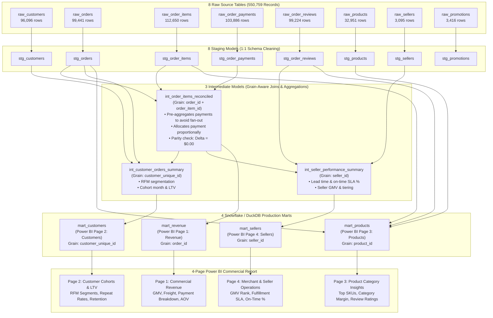

# E-Commerce Data Pipeline Architecture & Data Lineage

This document illustrates the end-to-end data lineage across the 8 raw source tables (550,759 records), 8 staging views, 3 intermediate models, and 4 Snowflake/DuckDB analytical marts feeding the 4-page Power BI executive dashboard.

---

## 1. End-to-End Data Lineage Diagram (Mermaid)

---

## 2. Grain Shift & Transformation Logic Summary

| Transition Step | Upstream Grain | Downstream Grain | Logic Applied | Key Risk Mitigated |
| :--- | :--- | :--- | :--- | :--- |
| **Raw $\to$ Staging** | Source raw records | Typed, normalized view | Type casting, timestamp parsing, standardized casing, whitespace stripping. | Dirty datatypes, malformed timestamps. |
| **Staging $\to$ `int_order_items_reconciled`** | Order items & Split payments | Single order item | Pre-aggregates payments to `order_id` in CTE; joins to items; allocates cash proportionally by item value share. | **Cartesian Fan-Out:** Prevents multi-item $\times$ multi-payment cross product duplication of revenue. |
| **Staging + Int $\to$ `int_customer_orders_summary`** | Individual orders | Unique customer individual (`customer_unique_id`) | Aggregates all orders by individual; extracts first/last order dates, lifetime spend, and computes RFM segmentation. | Miscounting repeat buyers who have different session `customer_id`s. |
| **Staging + Int $\to$ `int_seller_performance_summary`** | Line items & Reviews | Single seller merchant (`seller_id`) | Aggregates GMV, calculates delivery days vs estimated date SLA, computes on-time % and assigns performance tier. | Inaccurate SLA calculation across multiple items in an order. |
| **Intermediate $\to$ 4 Marts** | Pre-calculated summaries | Clean star-schema dimensions & facts | Final business ranking, categorization, and presentation metrics. | Heavy aggregations at BI visualization time. |
